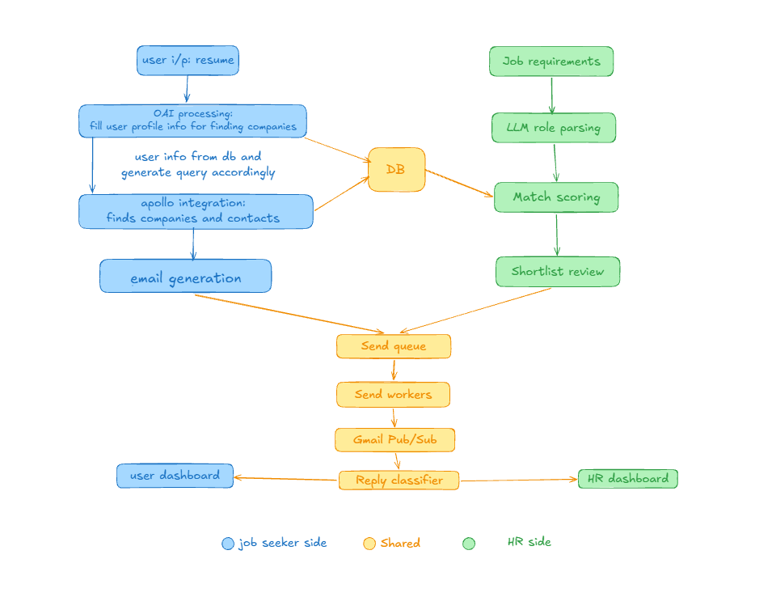

# Hunting Season

**Find the people who can get you hired, and reach them.**

Job boards put you in a queue behind four hundred other applicants. Hunting Season
skips the queue: it reads your résumé, finds companies that are actually hiring,
digs up the hiring manager and the recruiter by name, writes each of them a real
email from your background, sends it from your own mailbox, and then reads the
replies and tells you which ones matter.

It is a full-stack product, not a script: auth, billing credits, background
workers, provider webhooks, deliverability limits and an inbox.

---

## The loop

```
résumé  ─▶  career profile  ─▶  companies hiring  ─▶  the people there
                                                              │
   your inbox  ◀─  replies classified  ◀─  email sent  ◀───────┘
```

1. **Onboard.** Upload a résumé. It's parsed into a structured career profile
   (skills, seniority, field, highlights) that every later step reads from.
2. **Search companies.** Describe what you want in plain English
   (*"SaaS startups in the UAE hiring for sales roles"*). An LLM turns that into
   Apollo filters and returns companies that are actively hiring.
3. **Find the humans.** For each company, find up to two people worth contacting,
   usually a hiring manager and a recruiter, across three enrichment sources.
4. **Write and send.** Each contact gets an email written from *your* profile,
   sent from *your* Gmail or Outlook, paced to look human and stay deliverable.
5. **Handle replies.** Gmail Pub/Sub and Outlook subscriptions stream replies back.
   An LLM classifies each one and drafts a response for you to approve.

## Architecture



Three lanes: the **job-seeker pipeline** (blue), **shared infrastructure** (orange),
and a planned **HR-side** counterpart (green, see [Roadmap](#roadmap)).

Everything after "send" is asynchronous. A Redis-backed queue feeds a worker pool;
a scheduler re-enqueues recurring jobs: outreach runs, follow-up sweeps, mailbox
sync, Gmail watch renewals, Outlook subscription renewals, proposal expiry.

---

## How it works

### Company search

Your description becomes Apollo filters via an LLM, once. Pagination reuses the
same filters instead of re-prompting. 100 companies per page, up to 10 pages.

Search pages cache for 24 hours and job postings for 7 days, so anything another
user already fetched is free for you.

### Contact discovery

Three sources run in order, each filling only what's still missing:

| Source | Cost | What it gives |
|---|---|---|
| **Apollo** | free to search | Names and titles, masked until revealed |
| **Hunter** | 1 credit | Domain search, keeps people with a valid email |
| **Tavily** | 1 credit | LinkedIn web search, LLM extracts names from results |

Sources that find nobody refund their credit and cache negatives for 30 days.
People and companies are stored once and linked per user, so a revealed contact
is free for everyone after the first reveal.

**Auto Hunt** runs this continuously in the background against your saved criteria.

### From résumé to target titles

Nothing is scored against the résumé document itself. The résumé is read once,
by an LLM, into a structured career profile: current title, seniority, field,
skills, industries, years of experience, locations you are open to. That profile
is the input to everything downstream, which is why the quality of the parse
matters more than the quality of the PDF.

The profile becomes a **target title set**. Asking for "backend roles" as a
senior engineer does not search for "backend"; it expands into the titles of the
people who decide: engineering managers, heads of engineering, technical
recruiters, and the founders at companies small enough that the founder still
hires. Three contact types come out of this, and each company is worked for at
most two people:

| Type | Who | Why them |
|---|---|---|
| `hiring_manager` | The person the role reports to | Can create or push a req |
| `recruiter` | Talent acquisition, HR business partners | Owns the pipeline |
| `referrer` | Peers in the same function | A referral beats a cold application |

### Scoring a contact

Every candidate gets a single relevance score out of 100, built from signals that
add and signals that subtract. The point of the negative half is that a
bag-of-words title match is easy to fool: "Former Engineering Manager",
"Engineering Manager Intern" and "Assistant to the Engineering Manager" all match
*engineering manager* perfectly on words, and none of them can hire you.

**Positive signals**

| Signal | Points | Meaning |
|---|---|---|
| Base | 30 | Everyone found at a matching company starts here |
| Title overlap | up to 40 | Fraction of the target title's words present in theirs |
| Has an email | 15 | We can actually reach them |
| In your location | 15 | Same market as the roles you asked for |

**Negative signals**

| Signal | Points | Meaning |
|---|---|---|
| `former`, `ex`, `retired` | −30 | Right title, wrong tense |
| `intern`, `internship`, `trainee`, `student` | −25 | Matches the function, holds none of the authority |
| `apprentice`, `volunteer` | −20 | As above |
| `assistant to`, `executive assistant` | −20 | Adjacent to the decision maker, not the decision maker |
| `freelance`, `contractor` | −10 | Often real, rarely the hiring path |
| Culture mismatch | −15 | Company profile conflicts with what you asked for |

Two rules keep this honest. Title demotions are matched on **whole words**, so
"Senior Internal Auditor" is not an intern and "Head of Experience Design" is not
an ex-anything. And demotions are **capped at −40** in total, so a title is
demoted but never buried: someone with four bad markers still outranks a person
we know nothing about, because absence of information is not evidence of a bad
match.

The practical effect is ordering. A plain "Office Manager" outranks a "Former
Engineering Manager" even though the latter matches the target title twice as
well, because the score asks whether this person can help you *now*. Candidates
are sorted by score, the top one per contact type is taken, and the rest are kept
as spares for when a reveal fails or an email bounces.

### Outreach

Two writers. `email_agent` composes the entire email from your career profile and
needs no template. `template` personalises one you wrote, with `{contact_name}`,
`{company_name}`, `{role}` and `[[this|that]]` random variants.

If the AI is unavailable a template still sends as written, but `email_agent` sends
nothing rather than fall back to something generic.

Guardrails that make this survivable in a real mailbox:

- 20 emails/day per mailbox; new mailboxes warm up at 15/day for 3 days
- A fifth of each day's quota reserved for follow-ups
- Business-hours-aware scheduling with randomised send pacing
- Every address emailed is recorded, so re-adding a company never re-emails anyone
- Bounce rate surfaced over a 7-day window

Contacts move `new → contacted → hot` on reply, or `dead` when follow-ups run out.
Replying from your own mail client is detected and resets the follow-up clock.

### Inbox and replies

Threads are reconstructed from raw provider events, with quoted history stripped.
Incoming replies are classified by an LLM, which drafts a response and files it as
a **reply proposal** that you approve, edit or ignore. Approved replies count
against the same daily cap. Unactioned proposals expire on a timer.

### Credits

50 credits on signup, held in a wallet that never resets, so unused credits roll over.
Grants are idempotent per reason, so a monthly top-up job can call `credits.grant()`
repeatedly and it lands once per calendar month. Failed third-party calls refund.

---

## Stack

| | |
|---|---|
| **Frontend** | Next.js 16, React 19, Tailwind v4, TanStack Query, Redux Toolkit, Radix UI |
| **Backend** | FastAPI, SQLAlchemy 2 (async), Alembic, Pydantic v2 |
| **Data** | PostgreSQL, Redis |
| **Auth** | Clerk (JWT-verified server-side; no passwords stored) |
| **AI** | OpenAI: filter generation, résumé extraction, email drafting, reply classification |
| **Email** | Gmail API + Pub/Sub, Microsoft Graph + MSAL |
| **Enrichment** | Apollo, Hunter, Tavily |
| **Storage** | S3 (résumés) |

## Running it

Requires Python 3.12+, Node 20+, PostgreSQL and Redis.

```bash
# backend
cd backend
python -m venv .venv && .venv/Scripts/activate   # .venv/bin/activate on macOS/Linux
pip install -r requirements.txt
cp .env.example .env                             # fill in keys
alembic upgrade head
uvicorn api.main:app --reload --port 8000
python -m tasks.worker                           # second terminal

# frontend
cd frontend
npm install
npm run dev
```

Third-party keys are optional; sources without a key are skipped rather than
failing the run. See [`backend/README.md`](backend/README.md) for the full
environment reference and per-subsystem detail.

## Layout

```
backend/
  api/          routers, request/response models, service layer
  services/
    hunt/       company search, contact discovery, credits, Auto Hunt
    outreach/   drafting, eligibility, pacing, deliverability, limits
    email_event/  classification, reply proposals, thread assembly
    email_providers/  Gmail and Microsoft adapters
  tasks/        worker, scheduler, job handlers
  models/       SQLAlchemy models
  alembic/      migrations (0001 → 0023)
frontend/
  app/          routes: companies, contacts, inbox, profile, onboarding
  components/   UI by domain
  lib/          API client, query hooks, Redux slices
```

## Tests

```bash
cd backend && pytest        # 291 tests
```

## Roadmap

The green lane in the architecture diagram, **the HR side**, is designed but
not yet built. The idea is to run the same matching engine from the other
direction: an employer posts requirements, an LLM parses the role, candidates are
scored against it, and a shortlist goes out for review. Both sides would meet at
the shared send queue and reply classifier that already exist.

Nothing in the current codebase implements it yet.

---

*Résumé-onboarding flow and contact-relevance indexing contributed by
[Muntasir Mallik](https://github.com/muntaxir4).*
